# Control remoto de un vehículo agrícola no tripulado

Proyecto desarrollado por **Antonio Serrano Corral** como Trabajo Fin de Máster del Máster en Ingeniería Industrial de la Universidad de Córdoba (2021).

## Necesidad y objetivo

El proyecto aborda la necesidad de operar a distancia un vehículo agrícola multipropósito, evitando que el operario tenga que permanecer a bordo durante las maniobras en el campo. El objetivo fue desarrollar un sistema de control remoto para manejar sus funciones principales desde un mando inalámbrico y dar un primer paso hacia la futura automatización del vehículo.

Para resolverlo, se diseñó e implementó un mando basado en Arduino que transmite órdenes por radiofrecuencia a un receptor instalado en el vehículo. El receptor comunica las instrucciones al PLC mediante el bus CAN para controlar la traslación, la dirección y la nivelación manual y automática. El sistema se ensayó primero con un robot simulador y después mediante pruebas estáticas y dinámicas en el vehículo real.

## Solución técnica

El mando lee joysticks, selectores y pulsadores, procesa sus valores y prepara mensajes de control. El emisor utiliza un Arduino Mega 2560 y un módulo NRF24L01 para transmitirlos. En el vehículo, un Arduino Nano recibe los paquetes y una interfaz basada en MCP2515 los envía por CAN al PLC, encargado de gobernar las electroválvulas hidráulicas.

El mando incorpora pantalla Nextion, alimentación con baterías y BMS, y una carcasa diseñada en CAD e impresa en 3D. Se diseñó una PCB para sustituir el cableado provisional de protoboard por conexiones soldadas. También se añadió un módulo Bluetooth HC-05 para monitorización.

Durante las pruebas de campo, el módulo NRF24L01 estándar mostró un alcance limitado. Se sustituyó en el emisor y el receptor por la variante NRF24L01+PA+LNA, con la que se comprobó el funcionamiento a mayor distancia.

## Funciones y validación

- Traslación hacia delante y hacia atrás.
- Dirección delantera.
- Nivelación manual y nivelación automática mediante el inclinómetro y el PLC del vehículo.
- Pruebas de transmisión y recepción de órdenes CAN con un robot simulador en laboratorio.
- Ensayos estáticos y dinámicos del sistema instalado en el vehículo agrícola real.

## Arquitectura

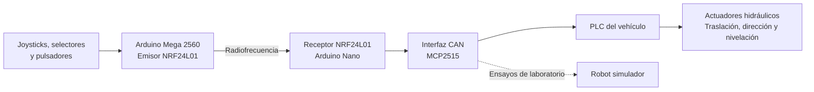

## Progreso del proyecto

La galería recoge hitos sucesivos del desarrollo, desde los prototipos y la fabricación hasta las pruebas en el vehículo.

### Mando: prototipo, diseño y fabricación

<table>
  <tr>
    <td>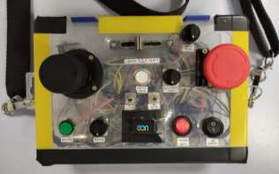<br><sub>Primer prototipo del mando</sub></td>
    <td>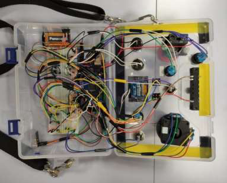<br><sub>Electrónica del prototipo</sub></td>
    <td>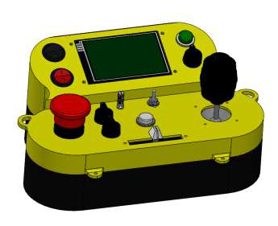<br><sub>Modelo CAD ensamblado</sub></td>
  </tr>
  <tr>
    <td>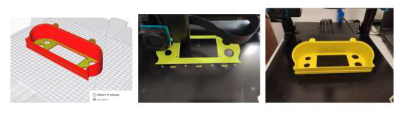<br><sub>Impresión 3D de la carcasa</sub></td>
    <td>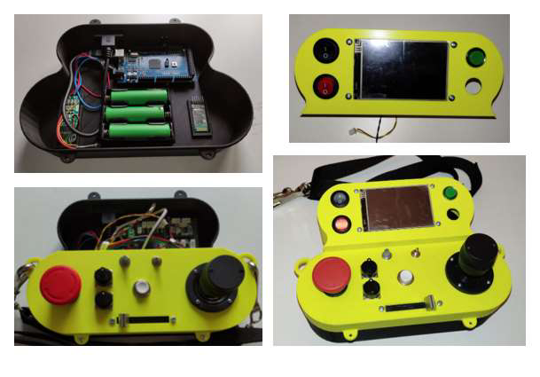<br><sub>Mando fabricado y ensamblado</sub></td>
    <td>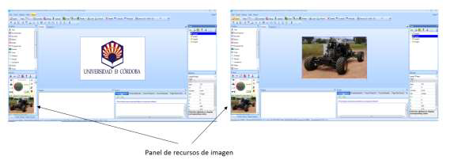<br><sub>Diseño de la interfaz Nextion</sub></td>
  </tr>
</table>

### Electrónica del emisor y el receptor

<table>
  <tr>
    <td>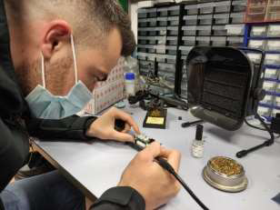<br><sub>Montaje y soldadura de la electrónica</sub></td>
    <td>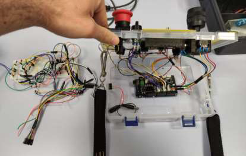<br><sub>Electrónica del mando</sub></td>
    <td>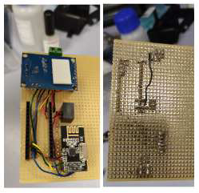<br><sub>Prototipo del receptor</sub></td>
  </tr>
  <tr>
    <td>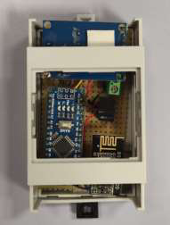<br><sub>Receptor dentro de su caja</sub></td>
  </tr>
</table>

### Robot simulador y validación en laboratorio

<table>
  <tr>
    <td>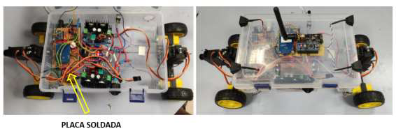<br><sub>Electrónica del robot</sub></td>
    <td>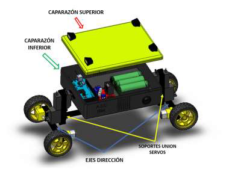<br><sub>Diseño CAD del robot</sub></td>
    <td>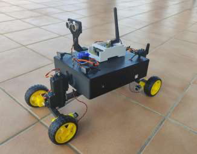<br><sub>Robot ensamblado</sub></td>
  </tr>
  <tr>
    <td>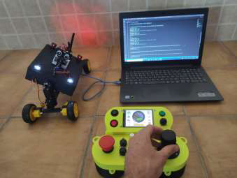<br><sub>Ensayo de órdenes CAN en laboratorio</sub></td>
  </tr>
</table>

### Integración y pruebas con el vehículo real

<table>
  <tr>
    <td>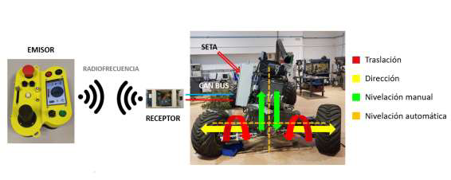<br><sub>Integración del sistema de control</sub></td>
    <td>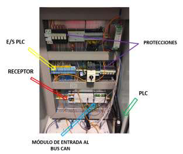<br><sub>Receptor conectado al cuadro eléctrico</sub></td>
    <td>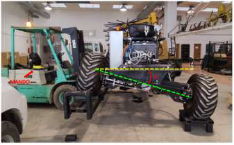<br><sub>Prueba estática de nivelación</sub></td>
  </tr>
  <tr>
    <td>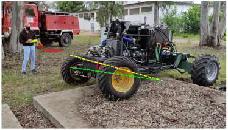<br><sub>Pruebas dinámicas</sub></td>
    <td>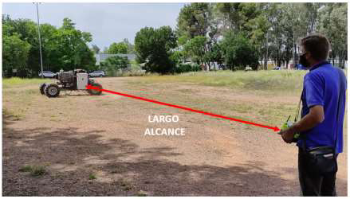<br><sub>Ensayo de alcance con antena</sub></td>
  </tr>
</table>

## Código

Los programas del emisor, el receptor y el robot simulador están organizados aquí por función:

| Archivo | Función | Hardware |
| --- | --- | --- |
| [`src/emisor/emisor.ino`](src/emisor/emisor.ino) | Lectura y tratamiento de controles; transmisión de órdenes y señal periódica de actividad | Arduino Mega 2560, NRF24L01, pantalla Nextion |
| [`src/receptor/receptor.ino`](src/receptor/receptor.ino) | Recepción de órdenes, envío transparente por CAN y gestión de pérdida de comunicación/parada | Arduino Nano, NRF24L01, MCP2515 |
| [`src/simulador/simulador.ino`](src/simulador/simulador.ino) | Lectura e impresión por serie de mensajes CAN para apoyar las pruebas | Arduino con MCP2515 |

Los archivos contienen el código del proyecto organizado para consulta. Antes de compilarlo o conectarlo a hardware, revisa su formato y configura la placa, el entorno y las bibliotecas compatibles. El repositorio no incluye una configuración de compilación reproducible de PlatformIO.

Las bibliotecas utilizadas incluyen RF24, MCP2515 y Nextion, además de las bibliotecas estándar de Arduino. La velocidad CAN configurada en el receptor es de 500 kbit/s. El cableado y los identificadores de mensaje deben corresponder a la configuración del PLC del vehículo.

## Estructura

```text
.
├── README.md
├── docs/
│   └── imagenes/          # Fotografías y diseños del proyecto
└── src/
    ├── emisor/emisor.ino
    ├── receptor/receptor.ino
    └── simulador/simulador.ino
```

## Referencia académica

**Serrano Corral, Antonio.** *Control remoto de un vehículo no tripulado agrícola*. Trabajo Fin de Máster, Máster en Ingeniería Industrial, Universidad de Córdoba, septiembre de 2021. Director: Rafael Rubén Sola Guirado.

El repositorio no especifica una licencia de reutilización para las imágenes y el código.
