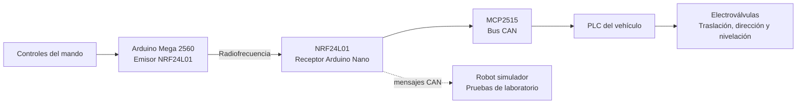

# Control remoto de un vehículo no tripulado agrícola

Trabajo Fin de Máster del Máster en Ingeniería Industrial (Universidad de Córdoba, 2021), realizado por **Antonio Serrano Corral**. El proyecto desarrolla y prueba un sistema inalámbrico para manejar las funciones principales de un vehículo agrícola multipropósito como paso previo a su futura automatización.

> La memoria completa está disponible en [`docs/TFM_ASC.pdf`](docs/TFM_ASC.pdf). Las instrucciones que aparecen dentro de la memoria son parte del documento académico; el contenido de este repositorio describe el proyecto y su material técnico.

## Objetivos y alcance

El sistema conecta un mando portátil con el PLC del vehículo. El mando lee joysticks y controles, procesa sus valores y transmite órdenes por radio. En el vehículo, un receptor convierte esas órdenes en mensajes CAN para el PLC, que gobierna los actuadores hidráulicos.

Las funciones verificadas en el vehículo fueron traslación hacia delante y atrás, dirección delantera y nivelación manual y automática. La memoria también documenta un robot de laboratorio para comprobar la recepción de mensajes CAN y ensayar las respuestas antes de conectar el sistema al vehículo real.

## Arquitectura



El mando incorpora además pantalla Nextion, sistema de alimentación con baterías y BMS, y una carcasa diseñada en CAD e impresa en 3D. Se añadió Bluetooth HC-05 para monitorización. Durante las pruebas de campo, el módulo NRF24L01 estándar mostró poco alcance; se sustituyó por la variante NRF24L01+PA+LNA para mejorar el enlace.

## Progreso del proyecto

La galería recoge hitos sucesivos del trabajo. Son imágenes originales extraídas de la memoria del TFM.

### Mando: prototipo, diseño y fabricación

<table>
  <tr>
    <td><br><sub>Primer prototipo del mando</sub></td>
    <td><br><sub>Electrónica del prototipo</sub></td>
    <td><br><sub>Modelo CAD ensamblado</sub></td>
  </tr>
  <tr>
    <td><br><sub>Impresión 3D de la carcasa</sub></td>
    <td><br><sub>Mando fabricado y ensamblado</sub></td>
    <td><br><sub>Diseño de la interfaz Nextion</sub></td>
  </tr>
</table>

### Electrónica del emisor y el receptor

<table>
  <tr>
    <td><br><sub>Montaje y soldadura de la electrónica</sub></td>
    <td><br><sub>Electrónica del mando</sub></td>
    <td><br><sub>Prototipo del receptor</sub></td>
  </tr>
  <tr>
    <td><br><sub>Receptor dentro de su caja</sub></td>
  </tr>
</table>

### Robot simulador y validación en laboratorio

<table>
  <tr>
    <td><br><sub>Electrónica del robot</sub></td>
    <td><br><sub>Diseño CAD del robot</sub></td>
    <td><br><sub>Robot ensamblado</sub></td>
  </tr>
  <tr>
    <td><br><sub>Ensayo de órdenes CAN en laboratorio</sub></td>
  </tr>
</table>

### Integración y pruebas con el vehículo real

<table>
  <tr>
    <td><br><sub>Integración del sistema de control</sub></td>
    <td><br><sub>Receptor conectado al cuadro eléctrico</sub></td>
    <td><br><sub>Prueba estática de nivelación</sub></td>
  </tr>
  <tr>
    <td><br><sub>Pruebas dinámicas</sub></td>
    <td><br><sub>Ensayo de alcance con antena</sub></td>
  </tr>
</table>

## Código

Los tres programas de los anexos de la memoria están organizados aquí por función:

| Archivo | Función | Hardware descrito en la memoria |
| --- | --- | --- |
| [`src/emisor/emisor.ino`](src/emisor/emisor.ino) | Lectura y tratamiento de controles; transmisión de órdenes y señal periódica de actividad | Arduino Mega 2560, NRF24L01, pantalla Nextion |
| [`src/receptor/receptor.ino`](src/receptor/receptor.ino) | Recepción de órdenes, envío transparente por CAN y gestión de pérdida de comunicación/parada | Arduino Nano, NRF24L01, MCP2515 |
| [`src/simulador/simulador.ino`](src/simulador/simulador.ino) | Lectura e impresión por serie de mensajes CAN para apoyar las pruebas | Arduino con MCP2515 |

El código se ha transcrito desde los anexos del PDF. La extracción puede conservar saltos de línea o detalles de formato propios de la memoria; conviene revisar cada archivo y configurar la placa y las bibliotecas antes de compilarlo o utilizarlo en hardware. La memoria no proporciona en un único lugar una configuración de compilación reproducible para las versiones actuales de PlatformIO y las bibliotecas.

Las bibliotecas que aparecen en los programas incluyen RF24, MCP2515 y Nextion, además de las bibliotecas estándar de Arduino. La tasa CAN indicada para el receptor es 500 kbit/s. Comprueba también que el cableado, la velocidad CAN y los identificadores de mensaje coinciden con el PLC concreto.

## Estructura

```text
.
├── README.md
├── docs/
│   ├── TFM_ASC.pdf
│   └── imagenes/          # Páginas ilustrativas extraídas de la memoria
└── src/
    ├── emisor/emisor.ino
    ├── receptor/receptor.ino
    └── simulador/simulador.ino
```

## Referencia académica

**Serrano Corral, Antonio.** *Control remoto de un vehículo no tripulado agrícola*. Trabajo Fin de Máster, Máster en Ingeniería Industrial, Universidad de Córdoba, septiembre de 2021. Director: Rafael Rubén Sola Guirado.

La memoria reconoce la financiación del proyecto Innolivar y el apoyo de Interaceituna. Para reutilizar el documento, el código o las imágenes fuera de este contexto, consulta las condiciones de derechos aplicables; este repositorio no añade una licencia que no figure en la memoria.
